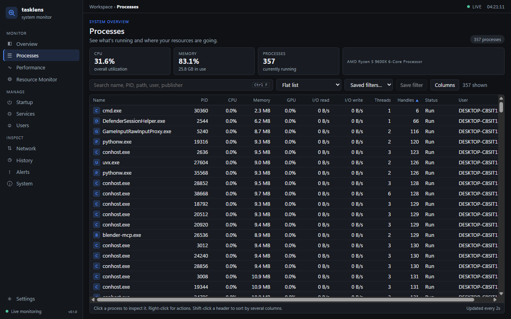
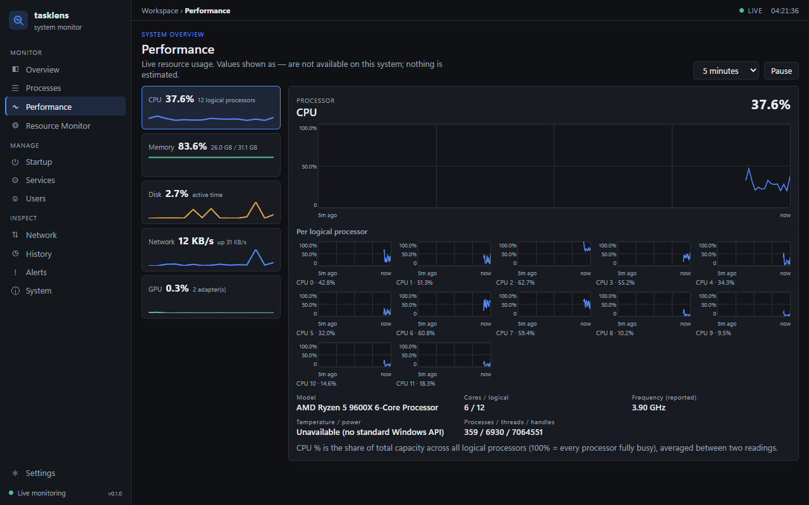
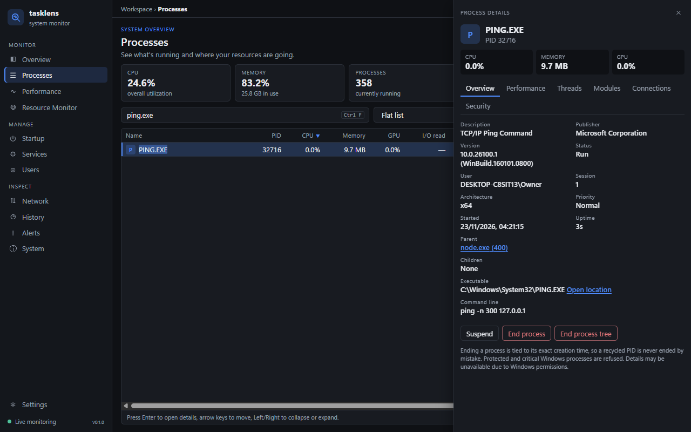
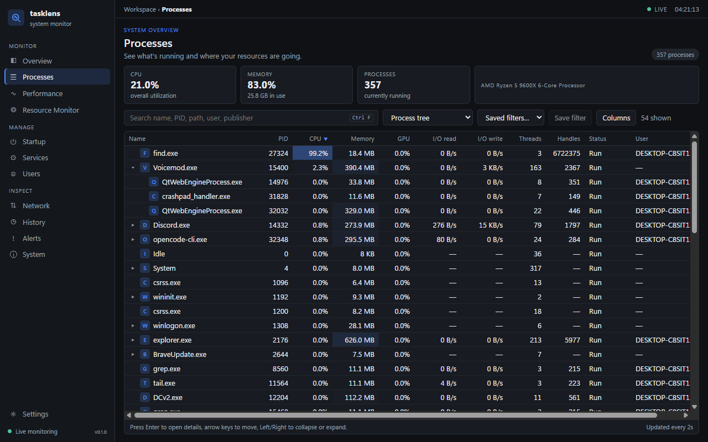
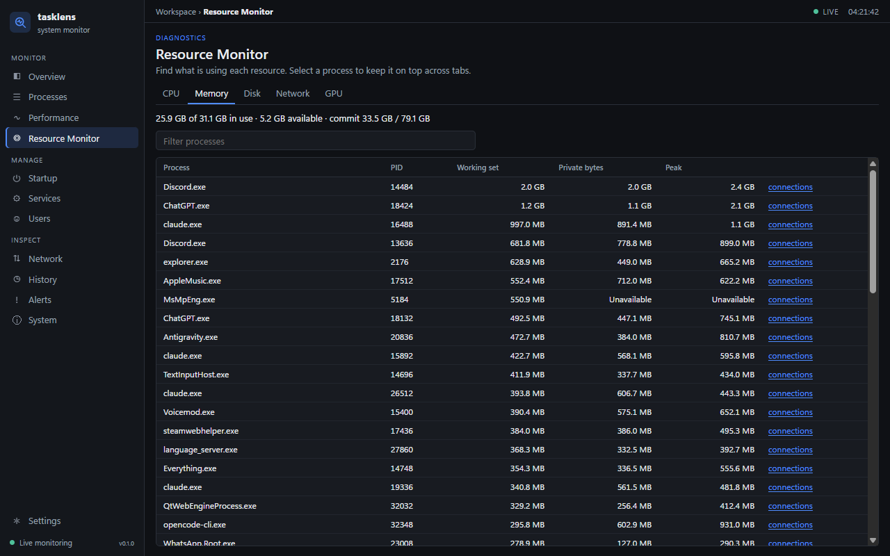

<p align="center"></p>

# TaskLens

An open-source Windows task manager replacement built with **Rust**, **Tauri 2** and **React + TypeScript**.
It combines Task Manager, Resource Monitor and Process Explorer-style inspection in one fast, local-only app.

> **Status: early pre-release (v0.1.0, unsigned).** Verified on Windows 11 x64 only. See
> [Known limitations](docs/KNOWN_LIMITATIONS.md) and the [release checklist](docs/RELEASE_CHECKLIST.md) before relying on it.

Maintainers: [@willmakesrandomshit](https://github.com/willmakesrandomshit) (Wil) and
[@mynameisjapan26-hue](https://github.com/mynameisjapan26-hue) (Elq).



*Screenshots are real captures of the running app (taken by the end-to-end test).*

## What it does

| Area | Highlights |
|---|---|
| **Processes** | 25 columns (resize, reorder, show/hide), multi-column sort, flat / tree / by-app / by-user / by-session views, pinned processes, saved filters, search with highlighting, keyboard navigation, usage heatmap, right-click actions |
| **Safe actions** | End process, end process tree, suspend/resume, priority, CPU affinity — every action is **verified against the process's exact creation time on the same handle**, so a recycled PID can never hit the wrong process. Critical/protected processes are refused. |
| **Inspector** | Overview (publisher, version, signature, parent/children, redacted command line), live per-process graphs, threads, modules, connections, security |
| **Performance** | CPU (per logical processor), memory (composition, commit, pools), disk (active time, response time, queue), network (status, link speed), GPU (engines, VRAM use) with pause and time ranges |
| **Resource Monitor** | Per-resource process rankings with a focus process that stays on top across tabs |
| **Startup / Services / Network / Users** | Run keys + Startup folders with reversible disable; Service Control Manager list/start/stop/restart (core services protected); TCP/UDP endpoints with owning process; sessions |
| **History & timeline** | Optional local SQLite history (bounded by age and size), spike timeline that separates *observations* from *correlations*, CSV export |
| **Alerts** | CPU/memory/GPU/disk/process thresholds with duration, cooldown and de-duplication. Alerts only notify. |
| **Everyday polish** | Dark/light/system theme, accent colors, density, text size, reduced motion, tray icon, compact always-on-top monitor, opt-in start with Windows |

<p align="center">
 <br>
 
</p>

## Principles
- **Real data only.** Unavailable metrics are shown as unavailable, never as zero. Temperatures, clocks and per-process
  network bandwidth are not available through standard Windows APIs and are not shown.
- **Local only.** No telemetry, accounts or network access. Settings and optional history live in
  `%APPDATA%\com.tasklens.monitor`.
- **Least privilege.** Runs as a standard user; it never tries to bypass access denials.

## Install
Pre-release builds are published on the [Releases page](https://github.com/willmakesrandomshit/tasklens/releases) once a
`v*` tag is pushed: an NSIS installer, a portable `.exe` and `SHA256SUMS.txt`. **Builds are unsigned**, so Windows
SmartScreen may warn. Requires Windows 10/11 with the WebView2 runtime (preinstalled on Windows 11).

## Build from source
Requirements: Rust (stable, MSVC toolchain + Visual Studio Build Tools), Node 22+, WebView2.
```powershell
npm ci
npm run tauri dev        # run with hot reload
npm run tauri build      # release exe + installer in src-tauri/target/release
```
Checks (the same ones CI runs):
```powershell
npm run typecheck; npm run lint; npm test
cargo fmt --manifest-path src-tauri/Cargo.toml --check
cargo clippy --manifest-path src-tauri/Cargo.toml --all-targets -- -D warnings
cargo test --manifest-path src-tauri/Cargo.toml
npm run e2e              # drives the real release exe; needs a prior `tauri build`
node tests/bench/bench.mjs src-tauri/target/release/tasklens.exe   # performance measurements
```

## Documentation
[Architecture](docs/ARCHITECTURE.md) · [Implementation status](docs/IMPLEMENTATION_STATUS.md) ·
[Test results](docs/TEST_RESULTS.md) · [Benchmarks](docs/PERFORMANCE_BENCHMARKS.md) ·
[Known limitations](docs/KNOWN_LIMITATIONS.md) · [Release checklist](docs/RELEASE_CHECKLIST.md) ·
[Contributing](CONTRIBUTING.md) · [Security policy](SECURITY.md)

## License
MIT — see [LICENSE](LICENSE).
